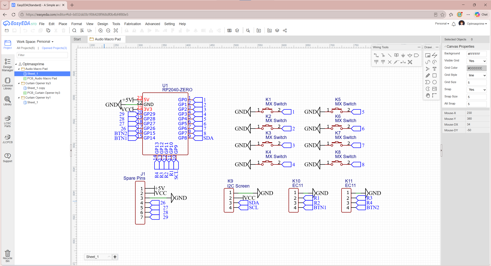
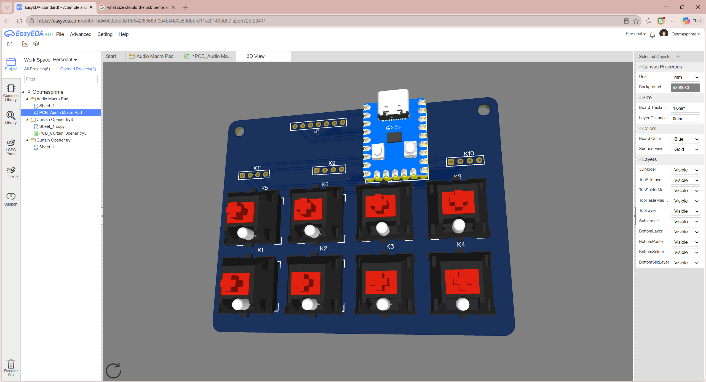
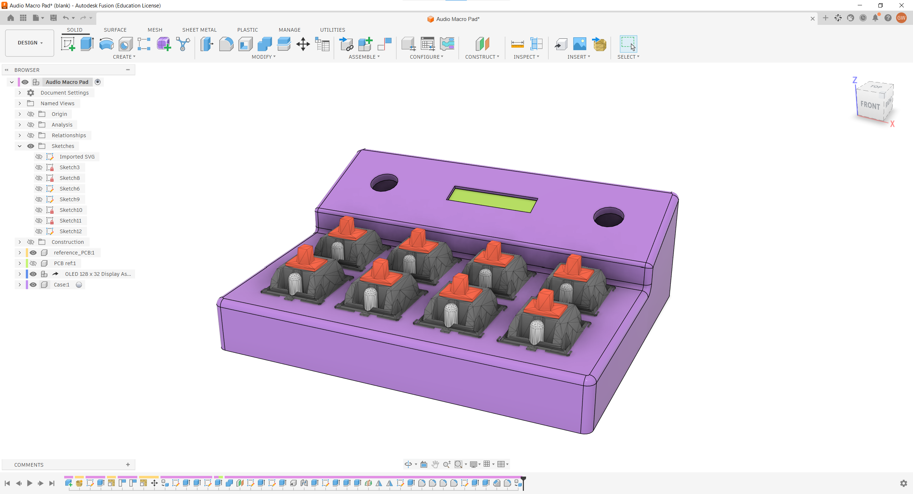

# Sound Pad

An instrument with precise rotary encoders for volume and frequency/pitch control.

Will have a custom PCB and a custom case. Will also have keyboard switches akin to a macro pad, so it it multi use. e.g. could be used as an instrument, sound board, synth, macro pad etc.

## Repo layout

All files needed to replicate it can be found in .\hardware. This includes the Gerber, schematic and PCB design files. \images contains images used in the documentation. Aside from the readme, other files are cloned from Half Life.

## PCB Design
Has a fairly simple PCB designed mainly to connect keyboard switches to a microcontroller. Namely a rp2040 zero.

### Schematic

A fairly simple schematic so could be wired by hand. but would need some way to attach the switches.

### PCB Render

PCB is under 100mm x 100mm so qualifies for the JLCPCB $4 prototype discount

## Case

Is a compact single piece case. Holds a 2 row set of 4 keyboard switches, and has a slooed upper shelf/plate for two rotary encoders and a screen.

## Code

Will likely configure with something like vial or qmk to output midi signals, so it is an "instrument"

## BOM

Will total less than $65 for 2 pads. 1 for each hand - theyll just be duplicates.

> Still to add